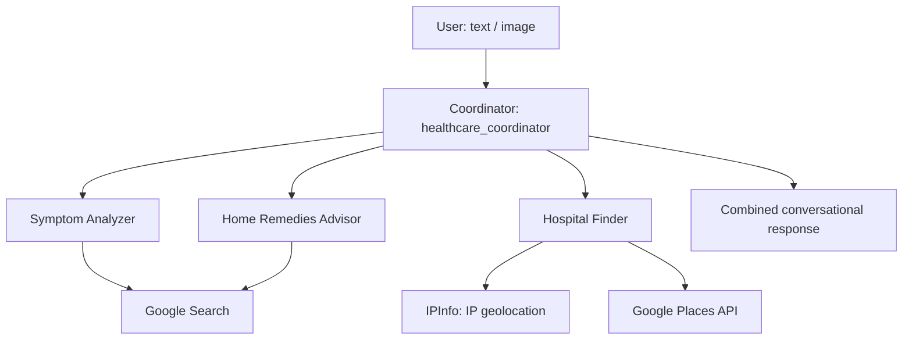

# Architecture

## Architectural style
A single-process Python application using an LLM-based coordinator with tool-wrapped specialist agents. Each specialist encapsulates its own prompt, model choice, and tools. External HTTP APIs are called synchronously by Python functions.

## Logical view

## Runtime composition
- `healthcare_agents/agent.py` creates the root `LlmAgent` named `healthcare_coordinator`.
- Each specialist is wrapped with ADK `AgentTool` and exposed to the coordinator.
- Symptom Analyzer uses `google_search`.
- Hospital Finder exposes `find_nearby_hospitals` through an ADK `FunctionTool`.
- Home Remedies Advisor uses `google_search`.
- Prompt text is centralized in `healthcare_agents/prompt.py`.
- Configuration is read from environment variables in `healthcare_agents/config.py`.

## Request lifecycle
1. ADK receives a user turn.
2. Coordinator prompt guides intent recognition and delegation.
3. Coordinator invokes one or more specialist tools.
4. Specialist calls its configured tools, if needed.
5. Tool results are returned to the specialist and coordinator.
6. Coordinator composes a response with relevant safety reminders.

The current source does not define a deterministic rules engine, explicit workflow state machine, or typed shared clinical data contract. Delegation is model-directed.

## Deployment view
- **Local:** Python environment + `.env` + `adk web`.
- **Cloud:** `deploy.py` packages/deploys the agent to Vertex AI Agent Engine using Google Cloud project, region, and staging bucket configuration.
- **Operational dependencies:** Google credentials, AI model access, Places API, network access, and appropriate IAM permissions.

## Design characteristics
| Concern | Current approach | Implication |
|---|---|---|
| Orchestration | LLM coordinator | Flexible, but delegation may vary by prompt/model |
| Agent isolation | Separate specialist modules | Prompts and tools are easier to evolve independently |
| Integration | Direct SDK/tool calls and HTTP requests | Simple, but timeouts/retries/error contracts are inconsistent |
| State | No persistent application store evidenced | No durable patient history |
| Configuration | Environment variables + dotenv | Easy local setup; validation needs alignment |
| Observability | Basic print/error output and cloud logs described | Limited structured tracing in application code |

## Recommended target architecture (not yet implemented)
Introduce a thin application/service layer around external APIs, typed request/response models, centralized timeout/retry policies, structured logs, explicit safety policy checks, and automated evaluation. Keep LLM agents responsible for language understanding and synthesis, not for enforcing critical emergency policy.
