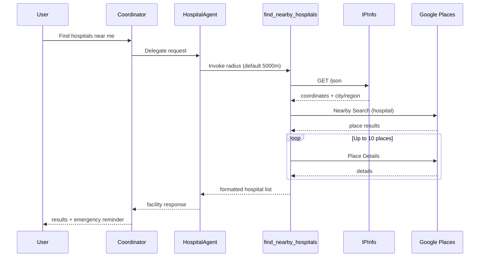

# Workflows and Use Cases

## Use case A — Symptom question
1. User describes one or more symptoms.
2. Coordinator delegates to Symptom Analyzer.
3. Specialist asks follow-up questions if context is insufficient.
4. Specialist may invoke Google Search for supporting information.
5. Coordinator returns a preliminary explanation, uncertainty, self-care boundaries, and advice to consult a clinician.

**Expected safety behavior:** no definitive diagnosis; urgent red flags trigger immediate-care guidance.

## Use case B — Image-assisted concern
1. User submits an image with a description or question.
2. Coordinator delegates to Symptom Analyzer.
3. Model examines image content if the ADK/model request actually carries the image.
4. Specialist describes observable characteristics and asks about onset, pain, progression, and related symptoms.
5. Response explains that image interpretation is preliminary and requires professional evaluation.

**Implementation note:** multimodal behavior is described in prompts and README. Verify the selected model, ADK UI, and deployed request path support image payloads end-to-end before treating this as a guaranteed feature.

## Use case C — Nearby hospital discovery
1. User asks for a hospital or medical facility.
2. Coordinator invokes Hospital Finder.
3. Tool requests IPInfo location.
4. Tool sends coordinates and radius to Google Places Nearby Search.
5. For up to 10 results, tool requests Place Details.
6. Tool formats available fields and returns them to the agent.
7. Agent explains options and includes the emergency reminder.

**Failure paths:** IP lookup failure, missing Places key, non-OK Places status, no usable details, HTTP/network exception.

## Use case D — Mild symptom / home remedy
1. Coordinator determines that the request concerns mild symptoms or explicitly asks for home remedies.
2. Home Remedies Advisor assesses whether the described symptoms fit its limited scope.
3. Specialist may use Google Search.
4. It returns preparation guidance, precautions, and signs that require medical attention.

**Safety rule:** when symptoms are severe, uncertain, worsening, or potentially emergent, route to Symptom Analyzer and/or Hospital Finder instead of offering home remedies as the primary response.

## Use case E — Combined symptom and hospital request
1. Coordinator sends the symptom portion to Symptom Analyzer.
2. If facility discovery is needed, it invokes Hospital Finder.
3. Coordinator combines the assessment and facility information.
4. Emergency instructions must appear before non-urgent explanatory content.

## Sequence — hospital lookup

## Conversation continuity
The current code delegates using ADK agent tools but does not define a custom patient profile, durable session database, or longitudinal medical history. Do not assume cross-session memory or persistence beyond the ADK runtime/session behavior.
